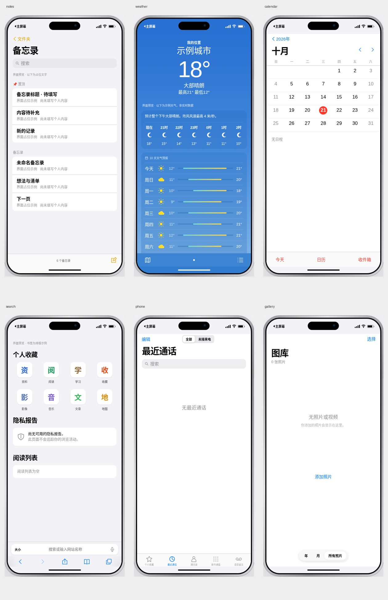

# 第二轮主屏与锁屏调整（未发布）

- [主屏：两块组件与四列应用](home-widgets-v2.png)
- [锁屏：更大的轻透时间字体](lock-light-v2.png)
- [手机尺寸主屏](home-mobile-v2.png)

官方第三方应用图标仍未下载成功：App Store 请求返回代理 403。已保存环境网络设置草稿，需要在“编辑环境 · 保存并发布”中保存并发布后才能重试。这次只是调整组件、排版与字体，第三方图标仍有待替换。

用户上传的图片仅用于锁屏；主屏保留系统风格背景。天气为本地季节模拟，非实时天气。

测试通过：两块组件、16 个图标网格、四种宽度无溢出或重叠、锁屏轻字重、组件和应用入口。

---

# 最新主屏幕与锁屏预览

- [主桌面（新版本）](home-latest.png)
- [手机尺寸下的主桌面](home-mobile-latest.png)
- [锁屏（上传的原图，仅用于锁屏）](lock-latest.png)
- [网易云音乐界面](music-latest.png)

桌面新增网易云音乐（可进入）、航海王热血航线、作业帮、学习通（仅图标）。其中新增第三方图标为识别性重绘标识，航海王使用草帽占位，并非从 App Store 获取的官方图标。查询官方图标的请求受代理 403 限制。正式图标可在之后提供文件替换。

密码为指定的四位密码。测试通过：锁屏原图与主屏壁纸独立、密码解锁、12 个桌面应用、三个仅展示图标、音乐页与标签切换，以及四种屏幕宽度。

这里只更新截图，尚未更新 main 分支或线上网站。

---

# iOS 界面预览

此分支仅保存截图，main 分支和线上网站未更新。

备忘录、书签为排版占位，天气为示例数据，不是人物私人内容或实时天气。

## 单张图片

- [备忘录](notes.png)
- [天气](weather.png)
- [日历](calendar.png)
- [Safari](safari.png)
- [电话](phone.png)
- [照片](photos.png)

## 新增：四位密码解锁

[查看密码界面](passcode.png)

解锁密码已设置。壁纸原图尚待通过文件附件传入，目前此图的背景仍为临时背景。

天气已按用户要求改为丰台区、南岸区本地模拟，可左右滑动切换，不联网查询。温度按季节与昼夜变化，明确标注“模拟天气 · 非实时数据”。此前天气截图是旧的布局示例。
